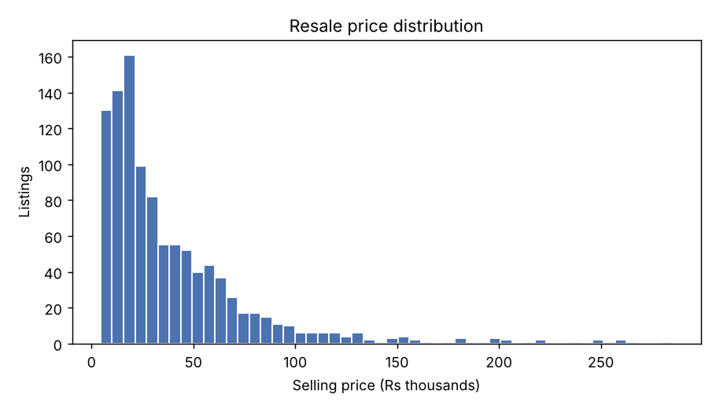
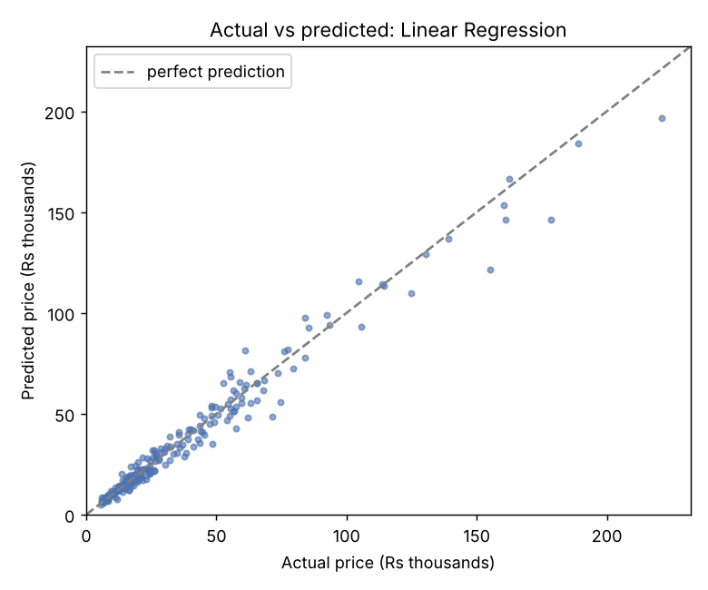
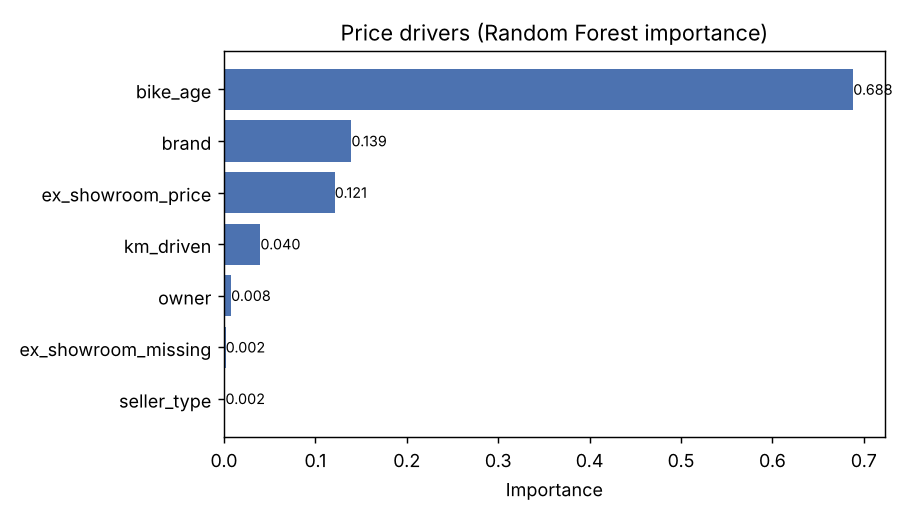

# Used Motorcycle Price Prediction

Predicts the resale price of used motorcycles from listing details, selects the best of three regressors by cross-validation, and ranks the factors that drive price.

> **Data note:** this repo ships a **synthetic** dataset (`data/BIKE_DETAILS_synthetic.csv`, 1,061 rows) with the same columns as the CarDekho motorcycle file. It was generated by `scripts/generate_synthetic_bikes.py` because the original file could not be downloaded when this project was built. The figures and metrics below describe the synthetic data, so they show how the pipeline works rather than real market prices. To get real results, replace the file with the original `BIKE DETAILS.csv` (see [Using real data](#using-real-data)) and rerun.

## Summary

| | |
|---|---|
| Dataset | Synthetic motorcycle listings, 1,061 rows (schema matches the CarDekho file) |
| Price range | Rs 4,500 to Rs 285,000 (median Rs 26,500) |
| Selected model | Linear Regression, chosen by 5-fold cross-validation on training data |
| Test result (scored once) | R² 0.970, RMSE Rs 6,321 on 213 held-out listings |
| Top drivers | `bike_age`, `brand`, `ex_showroom_price` |

## Price overview

<p align="center">
  
  
</p>

Prices are strongly right-skewed, which is why the model predicts `log(1 + price)`. Within each owner group, resale value falls steadily with bike age.

## Model selection

Models were compared with 5-fold cross-validation on the 80% training split, scored by R² on the log price. The 20% test set was not used for any choice, and it was scored once, for the selected model.

<p align="center">
  
</p>

| Model | CV R² (±std) |
|---|---|
| **Linear Regression** (selected) | 0.973 (±0.004) |
| Gradient Boosting | 0.965 (±0.002) |
| Random Forest | 0.946 (±0.005) |

## Test set results

<p align="center">
  
  
</p>

On the held-out test set, Linear Regression scores R² 0.970 and RMSE Rs 6,321, meaning a typical prediction is off by about Rs 6,300. Feature importance comes from a Random Forest fitted on the training data. `bike_age` dominates (0.69), followed by brand (0.14) and `ex_showroom_price` (0.12).

## Console output

<p align="center">
  
</p>

Full text is in [`docs/results.txt`](docs/results.txt).

## What it does

1. **Cleaning.** Removes duplicate rows and rows missing price, year or km driven. Drops non-positive prices and listings from model years after the reference year.
2. **Feature engineering.** Computes bike age from the model year, keeps the eight most common brands (others grouped as `Other`), and flags missing `ex_showroom_price` values before filling them with the median.
3. **Target.** Predicts `log(1 + price)` and converts predictions back to rupees for evaluation.
4. **Split.** 80% training, 20% test, seeded.
5. **Model selection.** 5-fold cross-validation on training data for Linear Regression, Random Forest, and Gradient Boosting. Best by CV R².
6. **Test.** The selected model is refitted on training data and scored once on the test set, in rupees.
7. **Drivers.** Sums Random Forest importances back to brand, seller type and owner type.

## Setup

```bash
python -m venv .venv
source .venv/bin/activate        # Windows: .venv\Scripts\activate
pip install -r requirements.txt
```

## Run

```bash
python bike_price_prediction.py --data data/BIKE_DETAILS_synthetic.csv --outdir docs
```

This prints the report, writes `docs/results.txt`, and regenerates everything in `docs/images/`. Use `--reference-year` to change the year used for bike age (default 2024, matching the synthetic data).

To regenerate the synthetic file:

```bash
python scripts/generate_synthetic_bikes.py
```

## Using real data

1. Download the CarDekho motorcycle dataset (`BIKE DETAILS.csv`) from Kaggle.
2. Place it in `data/` and run:

```bash
python bike_price_prediction.py --data "data/BIKE DETAILS.csv" --reference-year 2024 --outdir docs
```

The figures and `results.txt` will be regenerated from the real data. Update the numbers in this README to match.

## Tests

```bash
pip install -r requirements-dev.txt
pytest
```

Tests use generated listings, so they run without any data file. CI runs them on every push via GitHub Actions.

## Project layout

```
bike_price_prediction.py   # cleaning, features, CV model selection, test scoring, CLI
plots.py                   # figure and console-image generation
scripts/                   # synthetic dataset generator
data/                      # synthetic dataset (replace with real data for real results)
docs/                      # results.txt and images/ used in this README
tests/                     # pytest suite
```

## Notes

- Results on synthetic data are not market estimates. The generator builds prices from brand, age, km, owner and seller factors plus noise, so the model recovers that structure. Treat the metrics as a check that the pipeline works.
- `ex_showroom_price` is strongly tied to the new-bike price in the synthetic data, which inflates its importance. On real data this relationship is usually weaker and missing for many listings.
- The median used for `ex_showroom_price` is computed on the full dataset before splitting, a small amount of leakage acceptable for this scope.
- Bike age depends on the reference year. Pass `--reference-year` to keep results reproducible.
