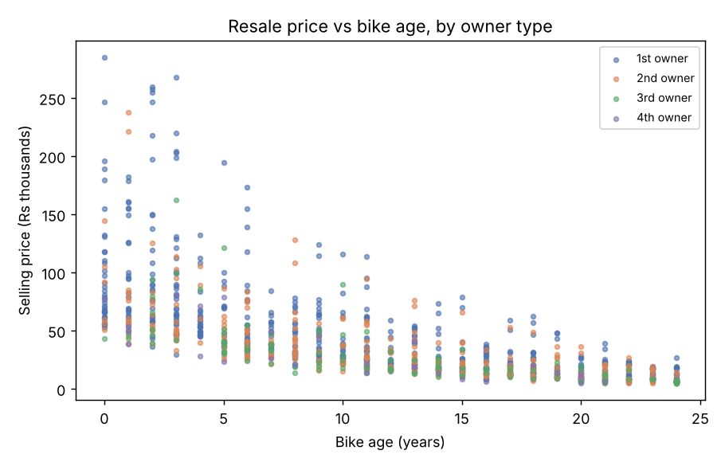
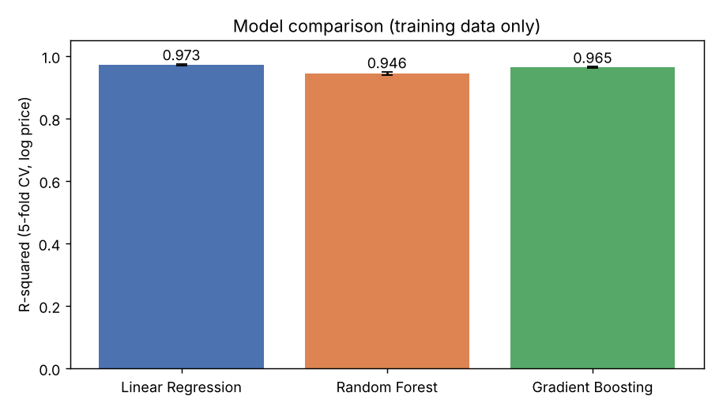
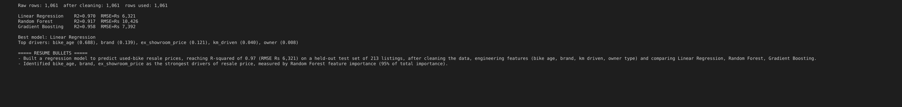

# Used Motorcycle Price Prediction

Predicts the resale price of used motorcycles from listing details, compares three regressors, and ranks the factors that drive price.

> **Data note:** this repo ships a **synthetic** dataset (`data/BIKE_DETAILS_synthetic.csv`, 1,061 rows) with the same columns as the CarDekho motorcycle file. It was generated by `scripts/generate_synthetic_bikes.py` because the original file could not be downloaded when this project was built. The figures and metrics below describe the synthetic data, so they show how the pipeline works rather than real market prices. To get real results, replace the file with the original `BIKE DETAILS.csv` (see [Using real data](#using-real-data)) and rerun.

## Summary

| | |
|---|---|
| Dataset | Synthetic motorcycle listings, 1,061 rows (schema matches the CarDekho file) |
| Price range | Rs 4,500 to Rs 285,000 (median Rs 26,500) |
| Best model | Linear Regression: R² 0.97, RMSE Rs 6,321 (on 213 test listings) |
| Top drivers | `bike_age`, `brand`, `ex_showroom_price` |

## Price overview

<p align="center">
  
  
</p>

Prices are strongly right-skewed, which is why the model predicts `log(1 + price)`. Within each owner group, resale value falls steadily with bike age.

## Model comparison

<p align="center">
  
</p>

| Model | R² | RMSE (Rs) |
|---|---|---|
| **Linear Regression** (selected) | 0.970 | 6,321 |
| Gradient Boosting | 0.958 | 7,392 |
| Random Forest | 0.917 | 10,426 |

## Best model results

<p align="center">
  
  
</p>

Feature importance comes from the Random Forest model. `bike_age` dominates, followed by brand and `ex_showroom_price`.

## Console output

<p align="center">
  
</p>

Full text is in [`docs/results.txt`](docs/results.txt).

## What it does

1. **Cleaning.** Removes duplicate rows and rows missing price, year or km driven. Drops non-positive prices and listings from model years after the reference year.
2. **Feature engineering.** Computes bike age from the model year, keeps the eight most common brands (others grouped as `Other`), and flags missing `ex_showroom_price` values before filling them with the median.
3. **Target.** Predicts `log(1 + price)` and converts predictions back to rupees for evaluation.
4. **Models.** Linear Regression, Random Forest, and Gradient Boosting on an 80/20 split with a fixed seed. Best by R².
5. **Drivers.** Sums Random Forest importances back to brand, seller type and owner type.

## Setup

```bash
python -m venv .venv
source .venv/bin/activate        # Windows: .venv\Scripts\activate
pip install -r requirements.txt
```

## Run

```bash
python bike_price_prediction.py --data data/BIKE_DETAILS_synthetic.csv --outdir docs
```

This prints the report, writes `docs/results.txt`, and regenerates everything in `docs/images/`. Use `--reference-year` to change the year used for bike age (default 2024, matching the synthetic data).

To regenerate the synthetic file:

```bash
python scripts/generate_synthetic_bikes.py
```

## Using real data

1. Download the CarDekho motorcycle dataset (`BIKE DETAILS.csv`) from Kaggle.
2. Place it in `data/` and run:

```bash
python bike_price_prediction.py --data "data/BIKE DETAILS.csv" --reference-year 2024 --outdir docs
```

The figures and `results.txt` will be regenerated from the real data. Update the numbers in this README to match.

## Tests

```bash
pip install -r requirements-dev.txt
pytest
```

Tests use generated listings, so they run without any data file. CI runs them on every push via GitHub Actions.

## Project layout

```
bike_price_prediction.py   # cleaning, features, modelling, evaluation, CLI
plots.py                   # figure and console-image generation
scripts/                   # synthetic dataset generator
data/                      # synthetic dataset (replace with real data for real results)
docs/                      # results.txt and images/ used in this README
tests/                     # pytest suite
```

## Notes

- Results on synthetic data are not market estimates. The generator builds prices from brand, age, km, owner and seller factors plus noise, so the model recovers that structure. Treat the metrics as a check that the pipeline works.
- `ex_showroom_price` is strongly tied to the new-bike price in the synthetic data, which inflates its importance. On real data this relationship is usually weaker and missing for many listings.
- Bike age depends on the reference year. Pass `--reference-year` to keep results reproducible.
